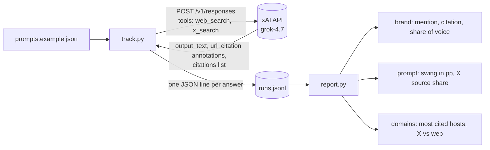

# Best Grok Tracking Tools

<p align="center">
  <a href="https://aiclicks.io/">
  </a>
</p>

Open the pricing page of almost any AI visibility vendor and Grok is there, usually in a row of small engine logos. Click through to the plan you can actually afford and it often disappears. Of the nine tools in this repo, three confirm Grok on the plan you see first and two more probably include it. The other four move it to an add on, a tier several hundred dollars higher, or an Enterprise contract with no public price. That gap is the whole reason this list exists. Most roundups of the [best grok rank tracker tools](https://aiclicks.io/blog/best-grok-tracking-tools) quote the sticker price. This one quotes the price of the plan that switches Grok on, and then subtracts.

The repo has two halves. The first is data: every price lives in [tools.yaml](tools.yaml), and [render_table.py](render_table.py) builds the table below from it and computes the Grok premium column itself, so a corrected price can never leave a stale total in the README. Prices were checked against each vendor's live pricing page on 29 October 2026. The second half is code: a small, dependency free Python tracker in [tracker/](tracker/) that sends your own prompts to Grok through the xAI Responses API with web and X search switched on, logs every answer and its sources, and reports mention rate, citation rate, share of voice and how much each prompt swings from day to day. Use it to sanity check any vendor on this list, or to run a few dozen prompts yourself before paying anyone.

```
.
├── tools.yaml                 vendor dataset, one entry per tool
├── render_table.py            tools.yaml -> README table, --check, --budget
├── tracker/
│   ├── track.py               prompts -> POST /v1/responses -> runs.jsonl
│   ├── report.py              runs.jsonl -> brand / prompt / domains / day views
│   ├── parse.py               pure helpers: text, citations, X vs web, mentions
│   └── prompts.example.json   brand, aliases, domains, competitors, prompts
├── examples/
│   ├── sample-response.json   Responses API shape the parser is tested against
│   └── sample-runs.jsonl      140 synthetic answers, fictional brands, for demos
├── tests/test_tracker.py      unittest, no network
└── .github/workflows/         table check, tracker tests on 3.9 and 3.12, link check
```

## Why Grok needs its own line item

Grok does not answer only from what it learned in training. According to xAI's own [search tools documentation](https://docs.x.ai/docs/guides/tools/search-tools), the model can call a Web Search tool and a separate X Search tool that reads posts on X in real time. A product thread that takes off on X in the morning can be inside Grok's answers by the afternoon, and gone again by the weekend.

Two buying rules follow from that, and both shape the columns below.

**Refresh rate matters more than it does for ChatGPT tracking.** A weekly check can miss a swing that started and ended between two runs. If your category lives on X (crypto, consumer tech, gaming, media), weight hourly or daily refresh above almost everything else.

**"Supports Grok" is a features page claim, not a plan claim.** The only Grok coverage that counts is the coverage on the plan you are going to buy. Where a vendor names Grok in general but not on that plan, the table marks it `(confirm)`.

## Comparison

<!-- TABLE:START -->
| Tool | Sticker price | Cheapest plan with Grok | Grok premium | Refresh | Trial | Best for |
| --- | --- | --- | --- | --- | --- | --- |
| [AIclicks](https://aiclicks.io) | $59/mo, Starter, monthly | $59/mo, Starter, Grok is one of the selectable models | None | Daily | 3 days, every plan | Teams that want Grok tracking plus a list of fixes on the entry plan |
| [Rankscale](https://rankscale.ai) | $17/mo, Essentials, billed yearly at $204 | $17/mo, Essentials, 17+ engines on every tier, Grok named on the homepage only | None (confirm) | Hourly to monthly, you pick | Free trial on Pro | Fast moving categories that need checks more often than once a day |
| [Mangools AI Search Watcher](https://mangools.com/ai-search-watcher) | €37.70/mo, Basic bundle, billed yearly | €37.70/mo, Basic bundle, Grok in the default engine list | None | Not stated | Free account, no card | SEO teams already paying for Mangools keyword tools |
| [Cairrot](https://cairrot.com) | $39/mo, Starter, ChatGPT and Perplexity only | $64/mo, Starter plus the Grok add on from $25 | +$25 | Not stated | Free trial | Builders who want an ungated API on the cheapest plan |
| [Rankability](https://www.rankability.com) | $97/mo, Starter, monthly | $97/mo, Starter, same 11 platforms on every paid tier | None | Daily | 7 days, card required | Agencies that track and also produce content for clients |
| [AthenaHQ](https://www.athenahq.ai) | Free, Essential, 5 engines without Grok | $295/mo, Starter, 3,600 credits across 11 models | +$295 | Not stated | Free Essential tier, no Grok | Teams that want GA4 and Search Console data next to Grok visibility |
| [AI Rank Checker](https://www.airankchecker.net) | $499/mo, Platform, 150 prompts, 5 platforms of your choice | $499/mo, Platform, Grok listed as an engine, choice of 5 not confirmed | None (confirm) | Not stated | None, demo only | Buyers who want a done for you service tier at $899 |
| [Orchly](https://orchly.ai) | $49/mo, Essential, monthly | Any plan plus a paid Grok add on, price not published | Not published | Daily | 7 days, every plan | Content teams that want article writing in the same tool |
| [Peec AI](https://peec.ai) | €85/mo, Starter, monthly, 3 models | Enterprise only, custom annual pricing | Not published | Daily | Not stated | Brands that only need Grok later and want clean reports on the other engines now |
<!-- TABLE:END -->

Prices change often and some vendors show annual rates by default. Confirm on the vendor's own page before you buy.

To see which tools fit a monthly budget once Grok is actually included:

```bash
pip install pyyaml
python render_table.py --budget 100
```

## Build your own Grok rank tracker

Every paid tool above does roughly the same thing under the hood: send a fixed prompt to Grok many times, keep the answer and its sources, and count. The tracker in this repo does that in about 350 lines of standard library Python, so you can see exactly what a "Grok visibility score" is made of.



### 1. Describe your brand and prompts

Copy [tracker/prompts.example.json](tracker/prompts.example.json) and edit it. `names` holds every spelling a mention can take, `domains` decides what counts as a citation of your site, and each prompt gets a stable `id` so history lines up across runs.

```json
{
  "brand": {"name": "Northwind Metrics", "names": ["Northwind Metrics", "Northwind"], "domains": ["northwindmetrics.example"]},
  "competitors": [{"name": "Fabrikam Rank", "names": ["Fabrikam Rank", "Fabrikam"], "domains": ["fabrikamrank.example"]}],
  "prompts": [{"id": "grok-tracker", "text": "Which rank tracker can monitor brand mentions inside Grok?"}]
}
```

Use prompts a buyer would type, the kind that come back as a list of vendors. Definitional prompts ("what is AI visibility") rarely name brands and add noise.

### 2. Collect answers

```bash
export XAI_API_KEY=your_key
python tracker/track.py --config my-brand.json --runs 5          # 5 samples per prompt
python tracker/track.py --config my-brand.json --dry-run         # print payloads, spend nothing
python tracker/track.py --config my-brand.json --no-x-search     # web only, for an A/B against X
```

Each call is the request shape from xAI's [search tools guide](https://docs.x.ai/docs/guides/tools/search-tools):

```json
{
  "model": "grok-4.7",
  "input": [{"role": "user", "content": "Which rank tracker can monitor brand mentions inside Grok?"}],
  "tools": [{"type": "web_search"}, {"type": "x_search"}]
}
```

`track.py` retries on 429 and 5xx with exponential backoff and appends one line per answer to `runs.jsonl`:

| Field | Source in the API response | Used for |
| --- | --- | --- |
| `text` | `output[].content[]` blocks of type `output_text` | mention detection |
| `citations` | top level `citations`, falling back to `url_citation` annotations | citation rate, domains, X share |
| `inline` | `[[N]](url)` links inside the text | sources a reader actually sees |
| `ts`, `prompt_id`, `run` | added by the script | daily swing, per prompt views |
| `usage` | `usage` | cost tracking |

Per xAI's [citations documentation](https://docs.x.ai/developers/tools/citations), the top level list holds every source the agent touched while searching, which is wider than what the answer cites inline. The script keeps both so you can choose the stricter definition.

Run it from cron once a day. Grok writes a fresh answer per call, so one sample per prompt is an anecdote. Five a day for a week is a trend.

### 3. Report

```bash
python tracker/report.py runs.jsonl --config my-brand.json              # brand view
python tracker/report.py runs.jsonl --config my-brand.json --by prompt
python tracker/report.py runs.jsonl --config my-brand.json --by domains --format csv
```

Output on the bundled synthetic log (`examples/sample-runs.jsonl`, fictional brands):

```
| brand             | answers | mention_rate | citation_rate | share_of_voice |
| Northwind Metrics | 140     | 54.3         | 21.4          | 25.3           |
| Fabrikam Rank     | 140     | 61.4         | 30.0          | 28.7           |
| Contoso Signals   | 140     | 50.7         | 19.3          | 23.7           |
| Tailspin SEO      | 140     | 47.9         | 20.7          | 22.3           |

| prompt_id      | answers | mention_rate | swing_pp | x_source_share |
| grok-tracker   | 35      | 40.0         | 33.8     | 46.2           |
| cheap-tracker  | 35      | 20.0         | 21.4     | 11.0           |
| agency-tracker | 35      | 77.1         | 16.7     | 14.2           |
| best-tracker   | 35      | 80.0         | 15.1     | 16.7           |
```

How each number is defined:

- **mention_rate**: answers that name the brand, divided by all answers. Matching is case insensitive and whole word, and URLs inside `[[N]](url)` markers are stripped first so a domain in a link never counts as a mention.
- **citation_rate**: answers whose `citations` include a URL on one of the brand's `domains`, subdomains included.
- **share_of_voice**: the brand's mentions divided by mentions of every tracked brand.
- **swing_pp**: population standard deviation of the daily mention rate, in percentage points. This is the Grok specific number. In the sample, `grok-tracker` draws 46% of its sources from X and swings about twice as much as `best-tracker` and `agency-tracker`, which lean on the open web.
- **x_source_share**: share of a prompt's cited URLs hosted on x.com or twitter.com.

A prompt with high swing and high X share is one where a single thread can put you in or take you out. That is where daily or hourly refresh from the vendors above earns its price, and where a weekly tool will mislead you.

### What this script does not do

It calls the API, not the consumer Grok app, so answers can differ from what a logged in user sees with their own history and location. It tracks one model at a time. It has no dashboard, no alerting and no recommendations. Those gaps are what the paid tools charge for, and the comparison table is there to help you decide which of them is worth it.

## The tools

### 1. AIclicks

AIclicks treats Grok as one of the models you pick during setup, and Grok is in the list on Starter. So the $59 plan is the Grok plan, with no premium. Each tracked prompt runs every day on every model you selected, and the dashboard records whether Grok mentioned you, whether it cited one of your URLs, and which competitors and sources showed up instead.

The part that justifies the top spot is what happens after the number. The Recommendations tab turns a missing mention into a specific job: a page to write, a cited article to get included in, a Reddit or YouTube thread already feeding the answer. Pro adds a Google Analytics integration so Grok referral sessions sit beside the visibility trend. Plan details and the model list are on the [pricing page](https://aiclicks.io/pricing), which is the fastest way to check whether this is the best grok seo rank tracker for your prompt count.

**Watch for:** Starter caps you at 30 prompts and 3 models, so adding Grok means choosing which two other engines to keep.
**Price:** $59, $189 and $499 per month, Enterprise custom, three day trial on every plan.

### 2. Rankscale

Rankscale is the only tool here that lets you set the refresh rate yourself, from hourly to monthly, on every tier. For a brand whose mentions move with X news cycles that is a real feature, not a settings menu. Pricing is credit based, so hourly checks burn credits fast.

**Watch for:** Essentials is sold yearly only ($204, about $17 a month) with 120 credits and no rollover. The pricing page lists 17+ engines without naming Grok, while the homepage names xAI Grok. Ask before relying on it at the bottom tier.
**Price:** Essentials about $17/mo yearly, Pro $99, Pro+ $229, Growth $385, Enterprise $780.

### 3. Mangools AI Search Watcher

Mangools tracks ChatGPT, AI Overviews, AI Mode, Gemini, Claude, Grok, Mistral and Llama, and Grok is in that default list rather than behind an upgrade. The catch is packaging. AI Search Watcher is not sold on its own, it comes inside the Mangools bundles alongside the keyword and SERP tools.

**Watch for:** you pay for the whole bundle even if you only want the AI tracking. If you already use Mangools for keyword research, that cost is sunk and this becomes the cheapest confirmed Grok plan on the list.
**Price:** from €37.70/mo billed yearly. A free account is available without a card.

### 4. Cairrot

Cairrot's $39 Starter tracks ChatGPT and Perplexity only. Pro and Enterprise go to five engines, and Grok is still not one of them. Grok is a separate add on from $25, which puts real Grok coverage at $64 a month or more.

**Watch for:** Starter covers 15 prompts, a thin sample for a model as volatile as Grok.
**Strength:** an ungated API on every plan, rare at this price.
**Price:** $39, $99 and $299 per month, plus the Grok add on.

### 5. Rankability

Rankability gives every paid plan the same 11 platforms, Grok included, so the Starter price is the Grok price. The product leans toward agencies: unlimited client workspaces, daily tracking, and content production credits bundled into the plans.

**Watch for:** the trial needs a card and has limited usage, so plan your test prompts before you start the clock.
**Price:** $97, $297 and $497 per month for 100, 300 and 500 tracked AI queries, or $970, $2,970 and $4,970 yearly.

### 6. AthenaHQ

AthenaHQ has the widest gap between first impression and Grok reality. The free Essential plan covers ChatGPT, Perplexity, AI Overviews, Gemini and Copilot, five engines and no Grok. Grok arrives with Starter at $295 a month, which buys 3,600 credits across 11 models.

**Watch for:** one credit equals one AI response, and API access plus extra credits are paid add ons on top of Starter.
**Strength:** GA4 and Search Console integrations on the paid plans.
**Price:** Essential free, Starter $295/mo, Enterprise custom, about 17% off on annual billing.

### 7. AI Rank Checker

Older roundups describe AI Rank Checker as a pay per check wallet with no subscription. That is out of date. Its pricing page now says the product was acquired by Cognizo and the wallet system was retired. What remains is a subscription: Platform at $499 a month for 150 prompts across five platforms you choose, and a Done for You tier at $899.

**Watch for:** Grok is in the engine list, but whether it can be one of your five Platform picks is not stated. There is no self serve checkout, only a demo booking.
**Price:** $499 and $899 per month, Enterprise custom.

### 8. Orchly

Orchly bundles ChatGPT, Google AI Overview and Perplexity into its plans and sells Gemini, AI Mode, Grok and Claude as paid add ons. The add on price is not published, so the Grok premium cell stays empty until you ask.

**Watch for:** Essential tracks 25 prompts. Pro adds article writing and refresh agents if you want content tools in the same place.
**Price:** Essential $49/mo, Pro $125/mo, lower on yearly billing, seven day trial on all plans.

### 9. Peec AI

Peec lets each paid plan choose three models from ChatGPT, AI Mode, AI Overviews, Copilot, Gemini and Naver AI. Grok is not on that list and not in the add on list either. It appears only in the Enterprise column.

**Watch for:** if Grok is the reason you are shopping, Peec is the wrong starting point today.
**Price:** Starter €85/mo or €70 yearly, Pro €205, Advanced €425, Enterprise custom.

### Dropped from the list

Profound appeared in earlier versions of the source roundup. Its current pricing page offers brands a free trial or a custom Enterprise plan and does not name Grok on any plan, including the agency engine list. Without a published Grok plan there was nothing honest to put in the table.

## How to choose

Answer these in order and the shortlist usually shrinks to two tools.

1. **Is Grok included on the plan you would actually buy?** Read the plan column, not the engine logos. AIclicks, Mangools and Rankability name Grok at their entry price. Rankscale and AI Rank Checker need a direct question. AthenaHQ, Cairrot, Orchly and Peec charge more for it.
2. **How fast does your category move on X?** If a single viral post can reshape the answers, you want daily checks at minimum and probably Rankscale's hourly option for launch weeks. Slower categories are fine on daily.
3. **Do you want a number or a next step?** A visibility rate tells you there is a gap. A tool that lists the sources Grok cited and what to do about each one tells you how to close it. AIclicks is built around the second kind, and most tools on this list stop at the first.

## FAQ

### What is a Grok rank tracker?

A Grok rank tracker sends a fixed set of prompts to Grok on a schedule and records whether your brand was mentioned, whether your page was cited as a source, and which competitors appeared instead. Grok writes a fresh answer each time, so the output is a mention rate and a citation count across many runs, not a single position like a Google ranking.

### Which is the best online grok rank tracker if I only need a quick check?

For a one time look before paying, run a few of your commercial prompts in Grok by hand and note who gets named. For a free structured snapshot, AIclicks has [free AI visibility tools](https://aiclicks.io/tools) and Mangools offers a free account. Ongoing tracking needs a paid plan with Grok on it, and the cheapest confirmed one in this repo is Mangools at €37.70 a month billed yearly, followed by AIclicks at $59 monthly.

### Does Grok need a separate tracker from ChatGPT?

Not a separate tool, but it does need explicit coverage. Grok can pull live posts from X through its X Search tool, which ChatGPT does not do, so a tracker that only polls ChatGPT and Perplexity will miss shifts that start on X. Pick a tool that names Grok on your plan.

### How do I see traffic coming from Grok?

In GA4, build an exploration or segment filtered on the session source for Grok's referral domain, then compare sessions and conversions with your other channels. Google Search Console will not show it because it only reports Google's own surfaces. Expect small numbers, since most AI answers are read without a click.

### Why are some prices in euros?

Mangools and Peec AI publish euro prices. The script keeps each vendor's own currency rather than converting, so the figures match what you will see at checkout.

## Contributing and credits

To fix a price or add a tool, edit [tools.yaml](tools.yaml), run `python render_table.py --write`, and open a pull request as described in [CONTRIBUTING.md](CONTRIBUTING.md). CI runs `--check` and fails if the table and the data disagree.

The shortlist started from the AIclicks roundup of [best Grok rank trackers](https://aiclicks.io/blog/best-grok-tracking-tools). AIclicks is featured first here and that is disclosed. The Grok premium column, the price corrections and the writeups are our own, checked against vendor pricing pages in October 2026. Vendor review scores were left out on purpose.

## License

MIT. See [LICENSE](LICENSE).
